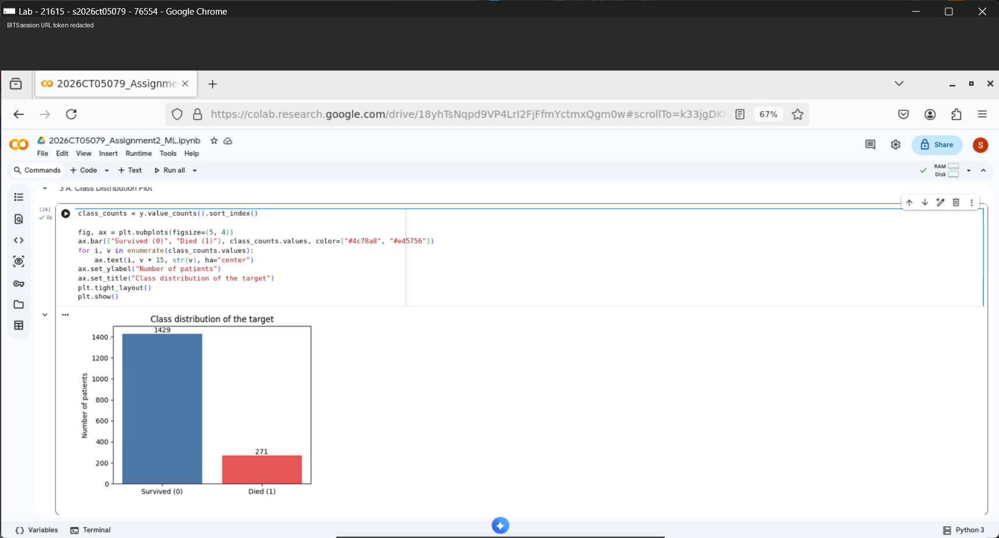
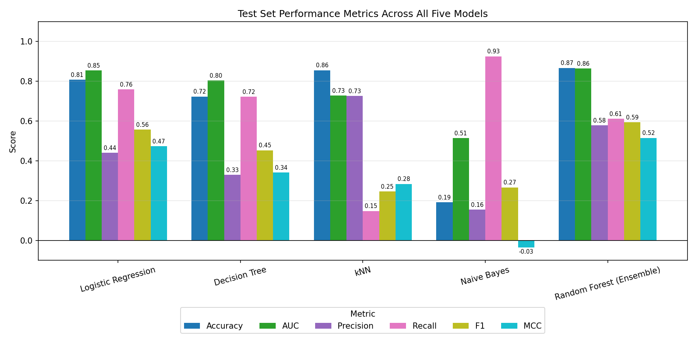
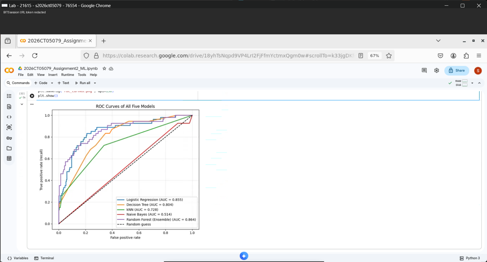
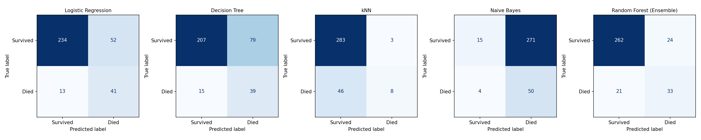
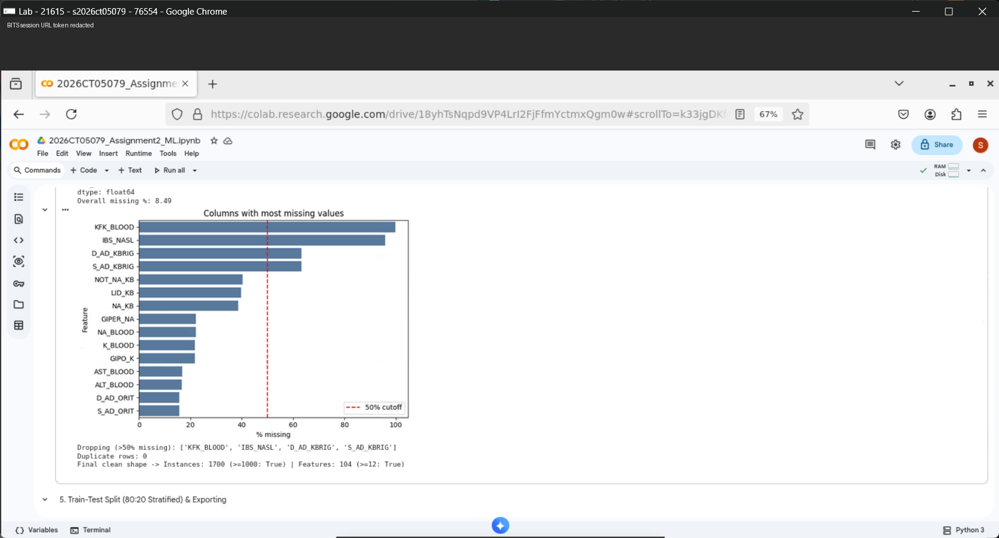
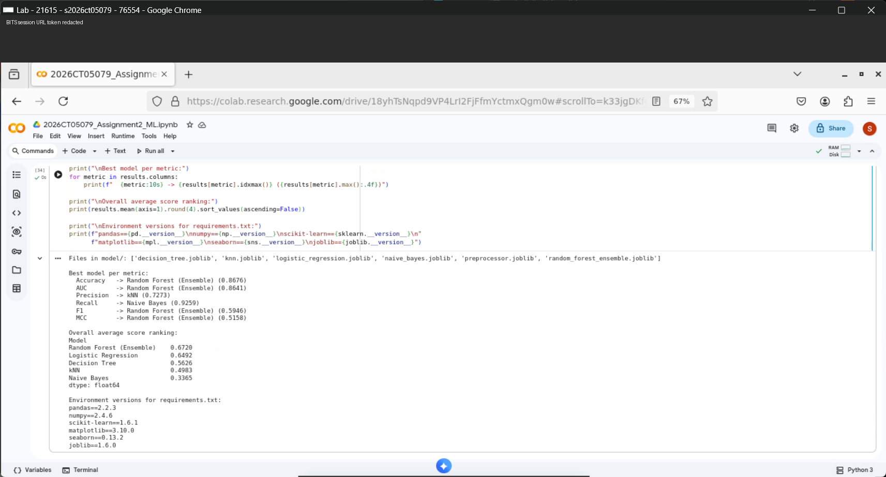

# Myocardial Infarction Complications — Lethal Outcome Classification

## 1. Problem statement

Acute myocardial infarction (MI) can lead to serious complications and in-hospital mortality. This project compares five supervised classification models for predicting the recorded binary lethal outcome (`LET_IS > 0`) using clinical admission, ECG, laboratory, and early ICU therapy data. Day-3 ICU measurements are excluded from the predictors; the project does not claim a specific 48-hour outcome horizon.

This is an educational machine-learning assignment, not a medical diagnostic tool.

## 2. Dataset description

- **Dataset:** Myocardial Infarction Complications Database
- **Source:** [UCI Machine Learning Repository, dataset 579](https://archive.ics.uci.edu/dataset/579/myocardial+infarction+complications), from Krasnoyarsk Interdistrict Clinical Hospital No. 20 (Golovenkin et al.).
- **Size:** 1,700 patient records and 124 original columns, including an ID, clinical input features, and outcome columns.
- **Selected predictors:** 104 features before encoding and 124 model-ready features after preprocessing.
- **Target:** `LET_IS`, converted from the original codes (0 = alive; 1–7 = causes of death) to a binary outcome:
  - Survived (0): 1,429 patients (84.06%)
  - Lethal outcome (1): 271 patients (15.94%)
- **Class balance:** 5.27:1 majority-to-minority ratio.
- **Feature types:** 77 binary indicators, 9 continuous measurements, 13 ordinal clinical codes, and 5 nominal or partially ordered categorical codes.

The dataset was selected because it is a public clinical classification dataset with more than 1,000 records and 12 features, contains meaningful missing-value and class-imbalance challenges, and supports a clinically relevant comparison of binary classifiers.



## 3. GitHub repository

[MyocardialInfarction--MLAssignment](https://github.com/2026ct05079-Shivanii/MyocardialInfarction--MLAssignment)

## 4. Models used and evaluation results

All models were fitted on the same stratified 80:20 split using seed 42. The held-out test set contains 340 patients (286 survived and 54 with lethal outcomes).

### Model configurations

| Model | Configuration |
|---|---|
| Logistic Regression | `max_iter=1000`, `class_weight="balanced"`, `random_state=42` |
| Decision Tree | `max_depth=5`, `min_samples_leaf=10`, `class_weight="balanced"`, `random_state=42` |
| kNN | `n_neighbors=7` |
| Naive Bayes | `GaussianNB` |
| Random Forest (Ensemble) | `n_estimators=300`, `max_depth=8`, `min_samples_leaf=5`, `class_weight="balanced"`, `random_state=42`, `n_jobs=-1` |

The fitted estimators use the same training-only preprocessing described below. The saved model artifacts were generated with scikit-learn 1.6.1; use the pinned version in `requirements.txt` when loading them.

| ML Model Name | Accuracy | AUC | Precision | Recall | F1 | MCC |
|---|---:|---:|---:|---:|---:|---:|
| Logistic Regression | 0.8088 | 0.8546 | 0.4409 | 0.7593 | 0.5578 | 0.4735 |
| Decision Tree | 0.7235 | 0.8038 | 0.3305 | 0.7222 | 0.4535 | 0.3424 |
| kNN | 0.8559 | 0.7281 | 0.7273 | 0.1481 | 0.2462 | 0.2844 |
| Naive Bayes (Gaussian) | 0.1912 | 0.5139 | 0.1558 | 0.9259 | 0.2667 | -0.0344 |
| Random Forest (Ensemble) | 0.8676 | 0.8641 | 0.5789 | 0.6111 | 0.5946 | 0.5158 |

### Metric visualizations







The original BITS captures of the metric comparison and confusion matrices are retained as [`09_Distorted_metrics_comparison_bits_capture.png`](model/screenshots/09_Distorted_metrics_comparison_bits_capture.png) and [`12distorted_confusion_matrices_bits_capture.png`](model/screenshots/12distorted_confusion_matrices_bits_capture.png). Those captures are clipped on the left; the complete charts above come from the notebook's full-resolution plot exports.

The notebook-generated plots are also available in [`model/plots/`](model/plots/): [metric comparison](model/plots/metrics_comparison.png), [ROC curves](model/plots/roc_curves.png), and [confusion matrices](model/plots/confusion_matrices.png).

### Model performance observations

| ML Model Name | Observation about model performance |
|---|---|
| Logistic Regression | A strong linear baseline (AUC 0.8546, MCC 0.4735). Balanced class weights yielded recall of 0.7593 (41 of 54 deaths identified) with precision of 0.4409. |
| Decision Tree | Recall was 0.7222 and AUC was 0.8038. Its precision (0.3305) and MCC (0.3424) were lower than Logistic Regression, with more false positives. |
| kNN | Accuracy (0.8559) and precision (0.7273) were high, but recall was only 0.1481 (8 of 54 deaths identified). Accuracy alone is misleading for this imbalanced dataset. |
| Naive Bayes | Weak overall performance (accuracy 0.1912, AUC 0.5139, MCC -0.0344). It predicted 321 of 340 test patients as positive, resulting in high recall (0.9259) but low precision (0.1558). |
| Random Forest (Ensemble) | Best balanced results: highest accuracy (0.8676), AUC (0.8641), F1 (0.5946), and MCC (0.5158). It identified 33 of 54 deaths, with 24 false positives. |

**Overall winner:** Random Forest (Ensemble), based on its leading AUC, F1, and MCC. This comparison is for the provided test split and is not evidence of clinical suitability.

## 5. Data preprocessing

- Removed the patient ID, the other 11 complication/outcome columns, and day-3 ICU features (`R_AB_3_n`, `NA_R_3_n`, `NOT_NA_3_n`) to avoid target leakage and restrict predictors to measurements available before day 3.
- Checked for duplicates; none were found.
- Dropped four features with more than 50% missing values: `KFK_BLOOD` (99.76%), `IBS_NASL` (95.76%), `D_AD_KBRIG` (63.29%), and `S_AD_KBRIG` (63.29%).
- Split the remaining records 80:20 with stratification and `random_state=42`.
- Fitted preprocessing on the training data only: median imputation and standard scaling for continuous features; most-frequent imputation and scaling for ordinal features; most-frequent imputation for binary features; and most-frequent imputation plus one-hot encoding for categorical features.
- Saved the held-out test features and target in [`test_data.csv`](test_data.csv).



## 6. Execution instructions and repository contents

The repository includes the requested files and saved models. The notebook stays directly inside `model/`; saved estimators, generated plots, and Prayogshala BITS Virtual Lab screenshots are grouped into separate subfolders.

```text
project-folder/
├── requirements.txt
├── README.md
├── test_data.csv
└── model/
    ├── Myocardial_Infarction_ML.ipynb
    ├── saved_models/
    │   ├── decision_tree.joblib
    │   ├── knn.joblib
    │   ├── logistic_regression.joblib
    │   ├── naive_bayes.joblib
    │   ├── preprocessor.joblib
    │   └── random_forest_ensemble.joblib
    ├── plots/
    │   ├── class_distribution.png
    │   ├── metrics_comparison.png
    │   ├── roc_curves.png
    │   └── confusion_matrices.png
    └── screenshots/
        ├── 01_notebook_overview_and_imports.png
        ├── 02_dataset_loading_code.png
        ├── 03_class_distribution.png
        ├── 04_missing_value_analysis.png
        ├── 05_stratified_split_and_feature_groups.png
        ├── 06_preprocessing_results.png
        ├── 07_metrics_table_output.png
        ├── 08_roc_curves.png
        ├── 09_Distorted_metrics_comparison_bits_capture.png
        ├── 10_metrics_comparison.png
        ├── 11_model_ranking_summary.png
        ├── 12distorted_confusion_matrices_bits_capture.png
        └── 13_confusion_matrices.png
```

1. Clone the repository and enter the project folder:

   ```bash
   git clone https://github.com/2026ct05079-Shivanii/MyocardialInfarction--MLAssignment.git
   cd MyocardialInfarction--MLAssignment
   ```

2. Install dependencies:

   ```bash
   python -m pip install -r requirements.txt
   ```

3. Download the CSV dataset from the UCI source linked above and place it at `data/Myocardial infarction complications Database.csv` under the project root. The raw dataset is not included in this repository.
4. From the project root, launch the notebook:

   ```bash
   jupyter notebook model/Myocardial_Infarction_ML.ipynb
   ```

5. Run the notebook cells in order. It loads the dataset, preprocesses and splits the data, trains the five models, and writes the model artifacts and evaluation plots. Skip the final Google Colab-only cell when running locally.

`requirements.txt` lists the Python dependencies. The saved estimators and fitted preprocessing pipeline are in `model/saved_models/`; generated plots are in `model/plots/`; Prayogshala screenshots are in `model/screenshots/`; the held-out test split is `test_data.csv`.

## 7. BITS Virtual Lab screenshot

The following screenshots document the notebook execution in Prayogshala BITS Virtual Lab. Temporary session-token text is redacted; the BITS lab identifier and notebook content remain visible.



